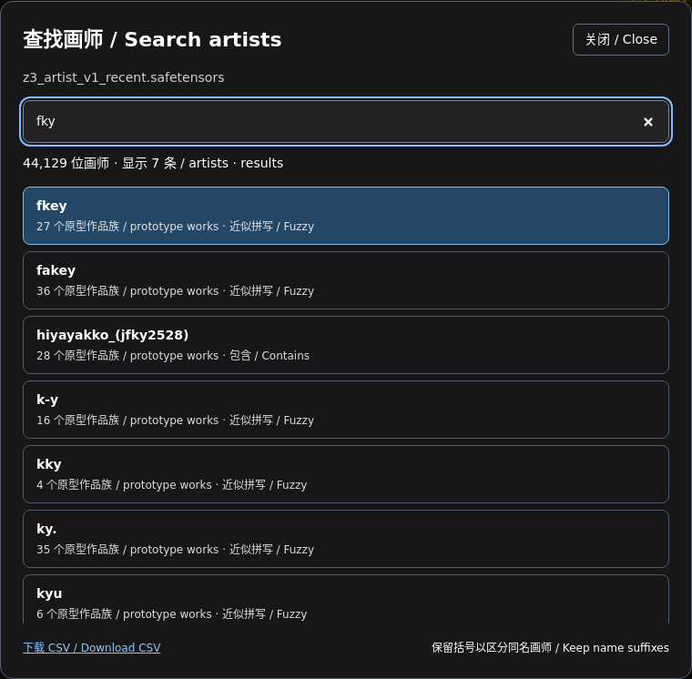

# Kaloscope Style Adapter for ComfyUI

Krea2 Raw / Turbo 与 MOSS Z3 风格适配节点，支持画师名称、加权多画师和参考图条件。
保留原有 `KaloscopeZ3*` 节点 ID 与工作流接口。基于 [comfyui-kaloscope](https://github.com/spawner1145/comfyui-kaloscope) 整理。

## 安装

```bash
cd ComfyUI/custom_nodes
git clone https://github.com/222222222l/Kaloscope-Style-adapter-Comfyui.git
# 使用运行 ComfyUI 的 Python；便携版请换成 python_embeded/python.exe
python -m pip install -r Kaloscope-Style-adapter-Comfyui/requirements.txt
```

重启 ComfyUI 并刷新浏览器。已安装 `comfyui-kaloscope` 扩展版时，先将旧包移出 `custom_nodes` 备份；两者包含相同节点 ID，**不要同时启用**。模型继续使用原来的目录。
ComfyUI 需要提供原生 Krea2 / MOSS 模型支持；本包不替代底模、文本编码器或 VAE。

```text
ComfyUI/models/
  kaloscope_z3/                 # Z3 adapter .safetensors，可同时保留多个检查点
  kaloscope_style_banks/        # 如 z3_artist_v1_recent.safetensors
  kaloscope/z3_artist_v1/       # 参考图编码器：config.json + model.safetensors
  diffusion_models/            # Krea2 Raw / BF16 Turbo，或对应 MOSS 底模
  text_encoders/               # 对应底模的文本编码器
  vae/                         # 对应底模的 VAE
```

代码仓库包含名称 CSV，**不包含模型权重**。名称条件需要匹配的风格库；参考图条件需要匹配的 artist-v1 编码器。仅复制 CSV 不能替代它们。

## 画师快速检索

1. 添加 **Kaloscope Z3 Artist Style** 或 **Kaloscope Z3 Artist Mix**，选择 `bank`。
2. 点击 **查找画师 / Search artists**，输入名称、部分关键词、已验证别名或近似拼写。
3. 点击结果，或用 ↑/↓ 和 Enter 选择。单画师节点写入 `artist_name`；混合节点追加到 `artist_tags`，保留已有权重。
4. 混合权重格式为 `fkey, (rolua:0.8)`。括号用于消歧的完整名称会保留；含特殊字符的名字在追加时自动转义。

内置 [data/artists.csv](data/artists.csv) 含 **44,129 位画师、105 个已验证别名**，并附原型作品族数量和特征集中度。
数据来自当前 `z3_artist_v1_recent` 风格库；[来源与校验信息](data/artists.json) 随包提供。

- 搜索结果以**当前选中的风格库实际包含的画师**为准。换用其他风格库时不会把内置 CSV 的名字错误当成该库已支持的名字。
- 未选择风格库时可以浏览内置目录；生成仍需安装并选择风格库。
- 精确名称与前缀优先，再综合关键词覆盖率和拼写近似度排序，避免长昵称偶然包含几字母就压过明显的拼写候选。大小写与空格/下划线可兼容，已验证别名可直接用于节点。
- 模糊匹配只给候选，**不会在运行时静默替换成其他画师**。例如 `feiqizi_(fkey)` 是角色名，不会自动替换为 `fkey`。
- 不移除括号后缀；同名但不同后缀的画师单独展示。按名字搜索不是按画风相似度搜索。
- `families` 表示构建名称原型使用的作品族数量，**不是全部训练图像数量**。
- 弹窗可下载当前所选风格库的 CSV。全部搜索在本机完成，无需外部服务或新增搜索依赖。



## 推理节点

| 节点 | 用途 |
| --- | --- |
| `KaloscopeZ3Loader` | 加载 Z3 adapter，输出检查点信息 |
| `KaloscopeZ3ArtistStyle` | 从风格库选择一个画师 |
| `KaloscopeZ3ArtistMix` | 多画师加权混合，支持搜索追加 |
| `KaloscopeZ3EncodeReference` | 用匹配的 DINOv3 artist-v1 编码参考图 |
| `KaloscopeZ3BlendFeatures` | 融合多组参考特征 |
| `KaloscopeZ3Apply` | 克隆 MODEL 并应用 Krea2 adapter |
| `KaloscopeZ3Sigmas` | 配合原生 `SamplerCustom` 使用对应采样时间表 |

MOSS 节点见 [MOSS 使用说明](README_MOSS_Z3_ZH.md)。现有特征提取和分析节点也保留，见 [原插件说明](README_LEGACY.md)。
旧版 Z3 示例和历史参数见 [README_Z3_ZH.md](README_Z3_ZH.md)，其早期 step12006 参数不是所有检查点的统一默认推荐。

本次 Raw / Turbo 配对验证所用设置，可作为同系列检查点的比较起点：

| 模型 | Euler 步数 | 文本 CFG | style_guidance | adapter_strength |
| --- | ---: | ---: | ---: | --- |
| Raw 63006 | 25 | 2 | 3.5 | 比较 1.0 与 0.8 |
| Turbo 从 63006 加训 | 8 | 1 | 1 | 比较 1.0 与 0.8 |

保持 seed、提示词、分辨率不变再比较强度。Fkey 的小样本测试中 0.8 常有更高风格余弦，但并非每个种子都提高；高余弦也不保证人体和构图更好。本次整理保留既有采样与残差注入计算。

## 本地接口与目录更新

```text
GET /kaloscope/style/artists?bank=z3_artist_v1_recent.safetensors&q=fky&limit=40
GET /kaloscope/style/artists/catalog.csv?bank=z3_artist_v1_recent.safetensors
```

省略 `bank` 返回内置目录；传入的 `bank` 必须存在于节点风格库列表。搜索最多返回 100 条，名称上限 160 字符。
名称索引按文件版本失效更新，不缓存模型权重。原有节点名称和输入输出保持兼容。

维护者可以从新风格库重新导出内置目录：

```bash
python scripts/export_artist_catalog.py /path/to/bank.safetensors --aliases /path/to/verified_aliases.json
```

别名 JSON 格式为 `{"mapping": {"old_name": "canonical_name"}}`；只应导入已核实的画师别名。

## 开发验证

```bash
python -m unittest discover -s tests -p 'test_artist*.py' -v
python -m unittest discover -s tests -p 'test_z3.py' -v
```

测试覆盖名称与别名、模糊候选、同名消歧、角色名拒绝、风格库替换、实际支持列表、CSV 下载、非法路径与既有混合公式。完整旧版 UI/API 测试额外需要 `requirements-webui.txt`。
前端按 [ComfyUI JavaScript 扩展接口](https://docs.comfy.org/custom-nodes/js/javascript_overview) 注册，搜索按钮不作为推理参数序列化。

## 许可

沿用上游 GPL-3.0，见 [LICENSE](LICENSE)。DINOv3 等已有代码保留原文件版权声明，模型权重适用各自许可。
